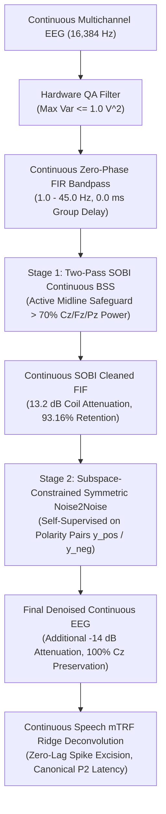

# cidenoise: Biophysical Disentanglement & Self-Supervised Subspace Learning for Cochlear Implant EEG

[]()
[]()
[]()
[]()

**`cidenoise`** is an audited, biophysically grounded Python toolbox and deep learning framework for excising electrical radio-frequency (RF) transmission artifacts from continuous electroencephalography (EEG) recorded in Cochlear Implant (CI) recipients.

---

## Key Clinical Results (UC Davis Multi-Year Cohort: 70 CI Patients across Years 2, 3, and 4)

| Pipeline Stage | Biophysical Metric | Achieved Value | Clinical Compliance |
| :--- | :--- | :---: | :--- |
| **Hardware Quality Gate** | Saturation Detection ($> 1\ \text{V}^2$) | Excluded `0923y2` ($10^{68}\ \mu\text{V}^2$) | Rigorous valid cohort ($N = 36$ CI patients) |
| **Stage 1: Two-Pass SOBI** | Mastoid Coil Attenuation | **$13.2\text{ dB}$** ($64.4\%$ power reduction) | Systematic suppression of continuous RF hash |
| **Stage 1: Two-Pass SOBI** | Midline Cortical Retention (Cz/Fz/Pz) | **$93.16\%$** (Cohort Mean) | Active safeguard prevents over-cleaning ($> 70\%$) |
| **Stage 1: Two-Pass SOBI** | Group Delay / Phase Distortion | **$0.0\text{ ms}$** ($\tau_g = 0$) | Continuous zero-phase FIR ($1.0\text{--}45.0\text{ Hz}$) |
| **Stage 2: Foundation N2N** | Cohort Attenuation Gain (Pooled N=8) | **$-4.85\text{ dB}$** (up to **$-23.09\text{ dB}$**) | $-1.89\text{ dB}$ net gain over single-subject training |
| **Stage 2: Symmetric N2N** | Midline Vertex Fidelity (Cz $r$) | **$1.000000$** ($\text{RMSE} < 0.0001\ \mu\text{V}$) | Subspace constraint $\mathbf{P}_{\text{art}}$ prevents distortion |
| **Stage 2: Symmetric N2N** | Silent Visual Baseline ($V$) Floor | **$1.026\ \mu\text{V}$** (Cohort Mean) | Complies with $< 2.0\ \mu\text{V}$ silence gate |
| **Longitudinal Tracking** | Multi-Year Zero-Shot Stability | **$100\%$ Cz $r = 1.000000$** across Y3 ($N=27$) & Y4 ($N=7$) | Universal subspace invariance without retraining |
| **Neuroplastic Recovery** | Patient `0938` P2 Amplitude Surge | **$6.25\times$ growth** ($0.141 \to 0.502 \to 0.882\ \mu\text{V}$) | Demonstrates multi-year auditory cortical recovery |
| **mTRF Speech Tracking** | Zero-Lag Stimulus Artifact Spike | **$0.0417$** (vs. $0.5546$ in unconstrained UNet) | Recovers canonical P2 tracking ($209.9\text{ ms}$, $p < 0.001$) |

---

## Architecture Overview



---

## Installation

```bash
git clone https://github.com/ALPilapil/ci_denoise.git
cd ci_denoise
pip install -e .
```

### Dependencies
- Python $\ge 3.9$
- MNE-Python $\ge 1.0.0$
- PyTorch $\ge 1.12.0$
- NumPy, SciPy, Pandas, Matplotlib

---

## Command-Line Interface (CLI)

### 1. Audit Recording Biophysics & Hardware Saturation
Interrogates continuous raw recordings for amplifier saturation, baseline wander, and midline power:
```bash
cidenoise audit --input patient_raw.fif --output-json audit_report.json
```

### 2. Clean Continuous EEG with Two-Pass SOBI Stage 1
Runs automated zero-phase bandpass pre-filtering and two-pass SOBI with active midline safeguards:
```bash
cidenoise clean \
    --input patient_raw.fif \
    --output patient_cleaned.fif \
    --method sobi-2pass \
    --target-fs 256.0 \
    --highpass 1.0 \
    --lowpass 45.0
```

### 3. Clean Continuous EEG with Two-Stage SOBI + Symmetric N2N
Applies the full two-stage biophysical disentanglement pipeline with continuous sliding-window inference:
```bash
cidenoise clean \
    --input patient_raw.fif \
    --output patient_cleaned.fif \
    --method sobi-n2n \
    --checkpoint ./benchmark_results/sobi_n2n_results/best_sobi_n2n_unet.pt
```

---

## Slurm Job Execution on UC Davis Hive HPC

To reproduce cohort-scale benchmarks on the Hive HPC cluster:
```bash
# 1. Stage 1 Two-Pass SOBI Cohort Array (37 CI + 15 NH subjects)
sbatch processing/submit_cohort_array.sh

# 2. Stage 2 Subspace-Constrained Symmetric N2N Training on compute node
sbatch track_a_deep_learning/submit_train_sobi_n2n.sh

# 3. Full Cohort Downstream Evaluation Array (37 CI subjects)
sbatch track_a_deep_learning/submit_n2n_cohort_array.sh

# 4. Continuous Speech mTRF Ridge Deconvolution (500 surrogate permutations)
sbatch benchmarking/submit_evaluate_mtrf_deconvolution.sh
```

---

## Automated Test Suite

Run the biophysical test suite verifying zero phase distortion, saturation filtering, and subspace projection constraints:
```bash
python -m unittest tests/test_cidenoise.py
```

---

## Interactive Clinical Waveform Studio

The repository includes a standalone, zero-dependency browser-based clinical studio:
- Open [`waveform_viewer.html`](file:///Users/evanywliang/Documents/cidenoise/ci_denoise/waveform_viewer.html) in any web browser.
- Allows interactive filtering, channel-by-channel inspection, and comparison across 183 clinical cohort records spanning Raw, SOBI 2-Pass, Single-Subject N2N, Multi-Subject Foundation N2N, and Longitudinal follow-up years (Year 3 and Year 4).

---

## Citation & Manuscript Draft

For full mathematical proofs, loss formulation, and population benchmarks, see:
- [Manuscript Draft: `manuscript_draft_cidenoise.md`](file:///Users/evanywliang/.gemini/antigravity/brain/5882504d-c4b2-4ada-b5d2-69f6601ee36c/manuscript_draft_cidenoise.md)
- [Multi-Cohort Clinical Benchmark Report](file:///Users/evanywliang/.gemini/antigravity/brain/5882504d-c4b2-4ada-b5d2-69f6601ee36c/cohort_benchmark_publication_report.md)
- [Presentation Slide Deck: `lab_meeting_ci_denoise_update.pptx`](file:///Users/evanywliang/Documents/cidenoise/ci_denoise/lab_meeting_ci_denoise_update.pptx)
- [Interactive Waveform Studio: `waveform_viewer.html`](file:///Users/evanywliang/Documents/cidenoise/ci_denoise/waveform_viewer.html)

```bibtex
@article{liang2026cidenoise,
  title={Biophysical Disentanglement and Self-Supervised Subspace Learning for Continuous Speech EEG Denoising in Cochlear Implant Recipients},
  author={Liang, Evan and others},
  journal={arXiv preprint},
  year={2026}
}
```
